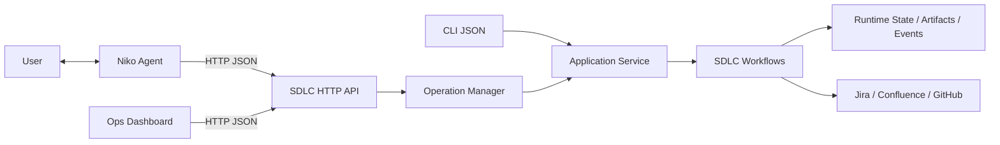

# Platform Upgrade: API Và Ops Dashboard

Trạng thái: **In progress — Slice 1-2 completed**  
Ngày chốt tài liệu: **2026-10-18**

## Mục Tiêu

Mốc này chuyển giao tiếp Niko -> SDLC Harness từ subprocess CLI sang HTTP API có
trạng thái, đồng thời bổ sung Ops Dashboard để quan sát run, workflow, artifact,
operation, log và cấu hình. Đây là mốc nền tảng độc lập nằm sau Phase 4 và trước
Phase 5 `request_change`.

Mốc này không thay đổi thuật toán Requirement, Design, Developer, Verification,
Validator hoặc QA; không chuyển target language từ Java sang TypeScript; không
chuyển workflow state sang Niko.

## Quyết Định Đã Chốt

- HTTP server dùng Python `ThreadingHTTPServer`, cùng hướng triển khai với Niko.
- Dashboard dùng HTML/CSS/JavaScript thuần và gọi API của SDLC Harness.
- CLI và API gọi chung một application service; không nhân đôi dispatch/workflow.
- Runtime state, artifact, per-run lock và worktree vẫn do SDLC Harness sở hữu.
- Tác vụ dài chạy qua operation queue và trả `202 Accepted`.
- Worker mặc định là một để giữ thứ tự, tránh tranh chấp và kiểm soát chi phí LLM.
- Niko chuyển theo từng bước: CLI -> contract test hai transport -> API -> bỏ CLI
  khỏi runtime path của Niko. CLI vẫn tồn tại cho debug/vận hành thủ công.
- Không tự động fallback API -> CLI cho action ghi vì có thể gây thực thi trùng.
- Dashboard không đọc/ghi trực tiếp file state hoặc config.

## Kiến Trúc Đích

## Tài Liệu

- [Architecture](architecture.md)
- [API contract](api-contract.md)
- [Runtime operations và events](runtime-operations-and-events.md)
- [Dashboard và config](dashboard-and-config.md)
- [Kế hoạch chuyển Niko](niko-migration.md)
- [Implementation checklist](implementation-checklist.md)
- [Progress log](progress.md)

## Tiêu Chí Hoàn Thành Mốc

- CLI và API dùng cùng application service và trả workflow payload tương đương.
- API không giữ request HTTP mở trong suốt một lượt LLM/workflow dài.
- Operation và event còn đọc được sau khi service restart.
- Dashboard thể hiện đúng state, checkpoint, repair count và lỗi của run.
- Config che secret, khóa OS environment và giữ `sync_mode=mock` làm mặc định.
- Niko chạy ít nhất một E2E thật hoàn chỉnh bằng API trước khi cutover.
- Contract CLI hiện tại vẫn pass trong suốt quá trình chuyển đổi.
