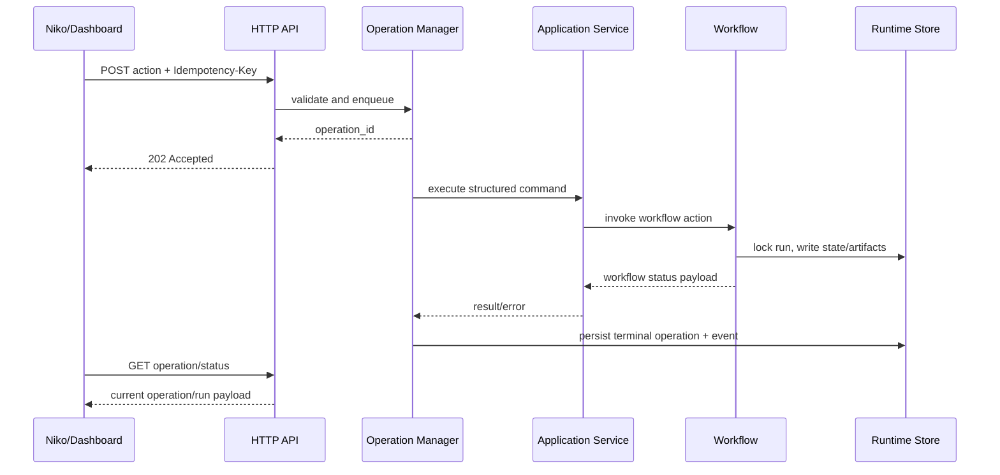

# Kiến Trúc API Và Ops Dashboard

## Baseline Và Trạng Thái Slice 1-6

Trước Slice 1, `sdlc_harness.interfaces.cli` vừa parse argument, dựng Settings vừa
dispatch trực tiếp tới workflow. Slice 1 đã chuyển settings + dispatch sang
`sdlc_harness.application.ApplicationService`; CLI hiện chỉ tạo
`ApplicationCommand`, gọi service và serialize JSON/exit code. Workflow vẫn sở
hữu state transition, artifact, sync và per-run lock.

Slice 2 đã thêm `interfaces/http.py` bằng `ThreadingHTTPServer` và
`ApplicationReadService`. HTTP adapter chỉ parse/auth/map status; read service
dựng projection công khai từ state đã persist, thay đường dẫn artifact bằng
metadata URL và chỉ đọc các artifact nằm trong allowlist. Các endpoint đọc không
tạo operation, không gọi LLM và không ghi state.

Slice 3 đã mở write endpoint qua operation queue bền vững. Slice 4 đã bổ sung event timeline theo run, cursor API và metadata quan sát đã lọc. Slice 5 phục vụ dashboard cùng origin, schema trình bày và operation theo run; frontend chỉ gọi `/api/v1`. Request được validate,
hash và persist operation/idempotency trước khi trả `202`; một worker gọi trực
tiếp application service. Mutation có run dùng runtime run lock chung cho CLI/API,
còn tạo run dùng source lock. Operation cũ không được replay sau restart.

## Thành Phần Đích

```text
interfaces/cli.py
  parse argv -> ApplicationService.execute(command)

interfaces/http.py
  GET -> ApplicationReadService -> ApplicationService.execute(get-status)
  POST action -> OperationManager.submit(command)
              -> ApplicationService.execute(command)

ops/frontend.py + ops/templates/
  allowlisted UI assets -> browser calls /api/v1 only

application/config_service.py + core/runtime_config.py
  schema projection -> masked values -> atomic config mutation

application/service.py
  validate command/action -> construct settings -> select workflow -> normalize result

application/read_service.py
  list/project state -> artifact allowlist -> path/secret sanitization

storage/runtime.py
  workflow state/artifacts + operation/event persistence + existing run locks

operations/
  atomic operation/idempotency store + bounded single-worker queue
```

`ApplicationService` là seam chung. Nó nhận command có cấu trúc và trả đúng
workflow payload hiện tại. Nó không chạy thread, không biết HTTP, không render UI
và không format câu trả lời Telegram.

`OperationManager` chỉ sở hữu queue, worker, idempotency và lifecycle của tác vụ
dài. Workflow vẫn là nơi duy nhất quyết định state nghiệp vụ.

## Luồng Ghi



## Quy Tắc Sở Hữu

- Niko sở hữu hội thoại, intent và cách diễn đạt kết quả.
- API sở hữu transport validation và HTTP mapping.
- Operation Manager sở hữu execution lifecycle, không sở hữu workflow state.
- Application Service sở hữu dispatch dùng chung cho CLI/API.
- Workflow sở hữu state transition, checkpoint, artifact và tool sync.
- Dashboard là API client; không được import workflow để chạy trực tiếp.
- Runtime Store là nguồn sự thật. Bộ nhớ trong server chỉ là cache/worker state.

## Concurrency Và Lock

- V1 cố định một worker; `SDLC_API_QUEUE_LIMIT=32` giới hạn số operation đang chờ.
- Mọi action ghi của run tiếp tục đi qua `RuntimeStore.run_lock(run_id)`.
- Hai action cùng run không được chạy đồng thời dù tăng số worker về sau.
- Read endpoint được phép phục vụ đồng thời và chỉ đọc snapshot đã ghi hoàn chỉnh.
- Ghi operation/state/config phải atomic theo cùng nguyên tắc temp-file + replace.
- Config save/reset giữ lock của Operation Manager trong lúc kiểm tra idle và ghi file,
  vì vậy không thể chen vào giữa một operation queued/running.

## Network Và Trust Boundary

- Mặc định bind `127.0.0.1`; port mặc định `7788`.
- Nếu bind ra địa chỉ không phải loopback, service phải từ chối khởi động khi chưa
  có `SDLC_API_TOKEN`.
- Niko gửi bearer token khi token được cấu hình.
- Dashboard cùng origin; không mở CORS mặc định.
- API không trả local absolute path, API key, token, prompt đầy đủ hoặc raw secret.

## Không Thuộc Mốc Này

- Thay đổi state machine nghiệp vụ Phase 1-4.
- Phase 5 `request_change`, resume/cancel đầy đủ hoặc auto merge.
- Distributed queue, Redis, database server hoặc multi-host deployment.
- Chuyển target code Java sang TypeScript.
