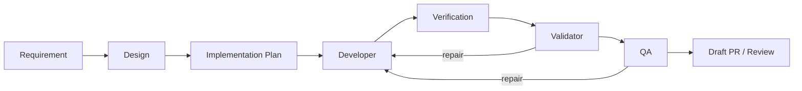

# Ops Dashboard Và Runtime Config

## Mục Tiêu UI

Dashboard giúp quan sát và vận hành SDLC Harness cục bộ. Nó không thay Niko làm
conversation gateway và không thay Jira/Confluence/GitHub làm collaboration tool.

Slice 5 đã triển khai các trang Runs, run detail, workflow, artifact/quality và
timeline. Slice 6 đã triển khai Config bằng schema backend, API ghi đồng bộ và
`.runtime/config.json` atomic.

## Các Trang

### Runs

- Danh sách run, source, phase, status, checkpoint, updated time và last error.
- Lọc theo source/status và mở run detail.
- Chỉ hiển thị action có trong `allowed_next_actions`.

### Workflow Flow

- Sơ đồ tĩnh của pipeline Phase 1-4.
- Overlay node hiện tại, node đã pass, checkpoint đang chờ và node bị block.
- Hiển thị repair iteration/budget của Design, Plan, Implementation và QA.
- Dữ liệu lấy từ state + event; không suy đoán bằng cách đọc tên file.



### Artifacts Và Quality

- Danh sách artifact key/version từ `latest_artifacts` và approved artifacts.
- Preview text/JSON qua artifact endpoint có whitelist.
- Quality report cho requirement/design/plan/code trace/QA và sync evidence.
- Không hiển thị absolute worktree path hoặc secret.

### Operations Và Logs

- Queue, running/terminal operation, duration và error code.
- Timeline event theo cursor để refresh tăng dần.
- Cho phép copy `run_id`, `operation_id`, error code; không dump token/prompt bí mật.

### Config

- Render từ schema backend, không hard-code danh sách key trong JavaScript.
- Nhóm: API server, LLM, repair/validation budgets, target workspace, sync tools.
- Field secret dùng password input và snapshot chỉ trả `********`/`is_set`.
- OS environment là read-only và hiển thị source.

## Config Precedence

```text
defaults < root .env < .runtime/config.json < OS environment < invocation/action override
```

CLI test/debug override chỉ có hiệu lực cho invocation đó và không được ghi vào
runtime config. API action argument chỉ override field được contract cho phép,
đặc biệt `sync_mode` và repair limit tương ứng.

`PUT /api/v1/config`:

- chỉ nhận key có trong schema;
- không cho ghi key đang bị OS environment khóa;
- giá trị mask gửi lại được hiểu là “không đổi secret”;
- validate type/range trước khi atomic write;
- trả snapshot hiệu lực đã mask;
- cấu hình cần restart phải có cờ `restart_required=true`;
- save/reset bị chặn bằng `409 config_busy` khi operation đang queued/running;
- reset nhận `keys`, `section` hoặc cả hai và chỉ xóa runtime override.

## Server Và Auth Config

- `SDLC_API_HOST=127.0.0.1`
- `SDLC_API_PORT=7788`
- `SDLC_API_TOKEN=`
- `SDLC_API_QUEUE_LIMIT=32`
- `SDLC_API_SHUTDOWN_TIMEOUT_SECONDS=30`
- `SDLC_RUNTIME_CONFIG_FILE=.runtime/config.json`

Host/port/token/runtime-config path là bootstrap config; dashboard không đổi chúng
trong lúc process đang chạy. Bind non-loopback bắt buộc token.
Slice 3 cố định một worker, chưa mở worker count thành runtime config.

## Action Safety

- UI yêu cầu xác nhận cụ thể cho `sync_mode=real`, approval, adoption và cleanup.
- Action button bị disable ngay sau submit và dùng idempotency key cho lần nhấn đó.
- Refresh trang không gửi lại POST.
- Dashboard chỉ báo thành công khi operation terminal thành công; `202` chỉ là đã queue.
